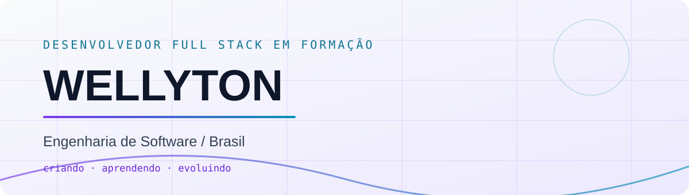

<!-- As imagens alternam conforme o tema ativo do GitHub. -->

<picture>
<source media="(prefers-color-scheme: dark)" srcset="./assets/hero.svg"/>
<source media="(prefers-color-scheme: light)" srcset="./assets/hero-light.svg"/>

</picture>
  
<picture>
<source media="(prefers-color-scheme: dark)" srcset="https://readme-typing-svg.demolab.com?font=JetBrains+Mono&size=19&duration=3400&pause=1200&color=67E8F9&center=true&vCenter=true&width=780&lines=Da+ideia+ao+projeto+funcionando.;Interfaces%2C+APIs+e+boas+experi%C3%AAncias.;Sempre+aprendendo.+Sempre+evoluindo."/>
<source media="(prefers-color-scheme: light)" srcset="https://readme-typing-svg.demolab.com?font=JetBrains+Mono&size=19&duration=3400&pause=1200&color=0E7490&center=true&vCenter=true&width=780&lines=Da+ideia+ao+projeto+funcionando.;Interfaces%2C+APIs+e+boas+experi%C3%AAncias.;Sempre+aprendendo.+Sempre+evoluindo."/>

</picture>
  
<a href="https://github.com/elitohn?tab=repositories"><picture>
<source media="(prefers-color-scheme: dark)" srcset="https://img.shields.io/badge/EXPLORAR_PROJETOS-17152b?style=for-the-badge&logo=github&logoColor=67e8f9"/>
<source media="(prefers-color-scheme: light)" srcset="https://img.shields.io/badge/EXPLORAR_PROJETOS-6d28d9?style=for-the-badge&logo=github&logoColor=ffffff"/>

</picture></a>

### 01 / SOBRE MIM
Sou estudante de **Engenharia de Software** e desenvolvedor **Full Stack em formação**. Construo aplicações web, interfaces responsivas, APIs e soluções com autenticação e persistência de dados. Gosto de aprender colocando a mão no código.

### 02 / TECNOLOGIAS

<picture>
<source media="(prefers-color-scheme: dark)" srcset="https://skillicons.dev/icons?i=python%2Cjs%2Cts%2Ccs%2Cjava%2Chtml%2Ccss%2Creact&theme=dark"/>
<source media="(prefers-color-scheme: light)" srcset="https://skillicons.dev/icons?i=python%2Cjs%2Cts%2Ccs%2Cjava%2Chtml%2Ccss%2Creact&theme=light"/>

</picture>
  
<picture>
<source media="(prefers-color-scheme: dark)" srcset="https://skillicons.dev/icons?i=django%2Cflask%2Cdotnet%2Csqlite%2Cgit%2Cgithub%2Cvscode%2Cvisualstudio&theme=dark"/>
<source media="(prefers-color-scheme: light)" srcset="https://skillicons.dev/icons?i=django%2Cflask%2Cdotnet%2Csqlite%2Cgit%2Cgithub%2Cvscode%2Cvisualstudio&theme=light"/>

</picture>

### 03 / PROJETOS EM DESTAQUE

<a href="https://github.com/elitohn/alura_space"><picture>
<source media="(prefers-color-scheme: dark)" srcset="https://github-readme-stats.vercel.app/api/pin/?username=elitohn&repo=alura_space&theme=transparent&hide_border=false&border_color=343154&title_color=a78bfa&text_color=cbd5e1&icon_color=67e8f9&locale=pt-br"/>
<source media="(prefers-color-scheme: light)" srcset="https://github-readme-stats.vercel.app/api/pin/?username=elitohn&repo=alura_space&theme=transparent&hide_border=false&border_color=e2e8f0&title_color=6d28d9&text_color=334155&icon_color=0e7490&locale=pt-br"/>

</picture></a>
<a href="https://github.com/elitohn/django_autenticacao-oauth"><picture>
<source media="(prefers-color-scheme: dark)" srcset="https://github-readme-stats.vercel.app/api/pin/?username=elitohn&repo=django_autenticacao-oauth&theme=transparent&hide_border=false&border_color=343154&title_color=a78bfa&text_color=cbd5e1&icon_color=67e8f9&locale=pt-br"/>
<source media="(prefers-color-scheme: light)" srcset="https://github-readme-stats.vercel.app/api/pin/?username=elitohn&repo=django_autenticacao-oauth&theme=transparent&hide_border=false&border_color=e2e8f0&title_color=6d28d9&text_color=334155&icon_color=0e7490&locale=pt-br"/>

</picture></a>
<a href="https://github.com/elitohn/screen-sound-csharp"><picture>
<source media="(prefers-color-scheme: dark)" srcset="https://github-readme-stats.vercel.app/api/pin/?username=elitohn&repo=screen-sound-csharp&theme=transparent&hide_border=false&border_color=343154&title_color=a78bfa&text_color=cbd5e1&icon_color=67e8f9&locale=pt-br"/>
<source media="(prefers-color-scheme: light)" srcset="https://github-readme-stats.vercel.app/api/pin/?username=elitohn&repo=screen-sound-csharp&theme=transparent&hide_border=false&border_color=e2e8f0&title_color=6d28d9&text_color=334155&icon_color=0e7490&locale=pt-br"/>

</picture></a>
<a href="https://github.com/elitohn/Pensamentos-CRUD-Aplica-o-JavaScript-com-API-REST"><picture>
<source media="(prefers-color-scheme: dark)" srcset="https://github-readme-stats.vercel.app/api/pin/?username=elitohn&repo=Pensamentos-CRUD-Aplica-o-JavaScript-com-API-REST&theme=transparent&hide_border=false&border_color=343154&title_color=a78bfa&text_color=cbd5e1&icon_color=67e8f9&locale=pt-br"/>
<source media="(prefers-color-scheme: light)" srcset="https://github-readme-stats.vercel.app/api/pin/?username=elitohn&repo=Pensamentos-CRUD-Aplica-o-JavaScript-com-API-REST&theme=transparent&hide_border=false&border_color=e2e8f0&title_color=6d28d9&text_color=334155&icon_color=0e7490&locale=pt-br"/>

</picture></a>

Cards conectados aos repositórios reais. As descrições são exibidas conforme os metadados do GitHub.

### 04 / ESTATÍSTICAS

<picture>
<source media="(prefers-color-scheme: dark)" srcset="https://github-readme-stats.vercel.app/api?username=elitohn&show_icons=true&hide_border=true&bg_color=0d1117&title_color=a78bfa&text_color=cbd5e1&icon_color=67e8f9&locale=pt-br&cache_seconds=21600"/>
<source media="(prefers-color-scheme: light)" srcset="https://github-readme-stats.vercel.app/api?username=elitohn&show_icons=true&hide_border=true&bg_color=ffffff&title_color=6d28d9&text_color=334155&icon_color=0e7490&locale=pt-br&cache_seconds=21600"/>

</picture>
<picture>
<source media="(prefers-color-scheme: dark)" srcset="https://github-readme-stats.vercel.app/api/top-langs/?username=elitohn&layout=compact&hide_border=true&bg_color=0d1117&title_color=a78bfa&text_color=cbd5e1&locale=pt-br&cache_seconds=21600"/>
<source media="(prefers-color-scheme: light)" srcset="https://github-readme-stats.vercel.app/api/top-langs/?username=elitohn&layout=compact&hide_border=true&bg_color=ffffff&title_color=6d28d9&text_color=334155&locale=pt-br&cache_seconds=21600"/>

</picture>

### 05 / TRILHA DE CONTRIBUIÇÕES

<picture>
<source media="(prefers-color-scheme: dark)" srcset="https://raw.githubusercontent.com/elitohn/elitohn/output/github-contribution-grid-snake-dark.svg"/>
<source media="(prefers-color-scheme: light)" srcset="https://raw.githubusercontent.com/elitohn/elitohn/output/github-contribution-grid-snake.svg"/>

</picture>
 A cobrinha aparece depois da primeira execução da ação automatizada.
  
<b>TRANSFORMANDO IDEIAS EM PROJETOS REAIS.</b>
 Criando · Aprendendo · Evoluindo

