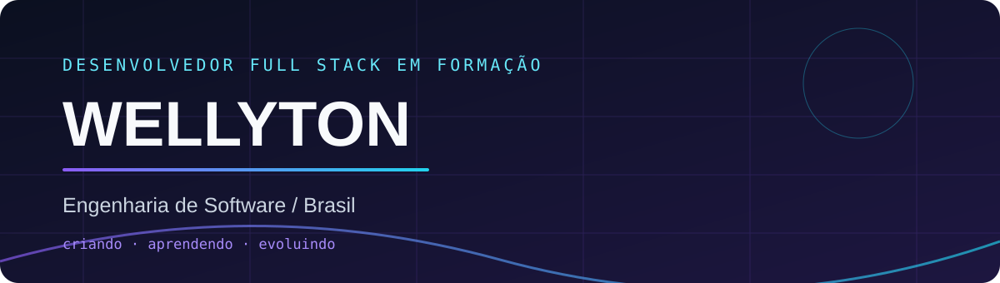

  

  

### 01 / SOBRE MIM
Sou estudante de **Engenharia de Software** e desenvolvedor **Full Stack em formação**. Construo aplicações web, interfaces responsivas, APIs e soluções com autenticação e persistência de dados. Gosto de aprender colocando a mão no código.

### 02 / TECNOLOGIAS

  

### 03 / PROJETOS EM DESTAQUE

Cards conectados aos repositórios reais. As descrições são exibidas conforme os metadados do GitHub.

### 04 / ESTATÍSTICAS

### 05 / TRILHA DE CONTRIBUIÇÕES

<picture>
<source media="(prefers-color-scheme: dark)" srcset="https://raw.githubusercontent.com/elitohn/elitohn/output/github-contribution-grid-snake-dark.svg"/>
<source media="(prefers-color-scheme: light)" srcset="https://raw.githubusercontent.com/elitohn/elitohn/output/github-contribution-grid-snake.svg"/>

</picture>
 A cobrinha aparece depois da primeira execução da ação automatizada.
  
<b>TRANSFORMANDO IDEIAS EM PROJETOS REAIS.</b>
 Criando · Aprendendo · Evoluindo

